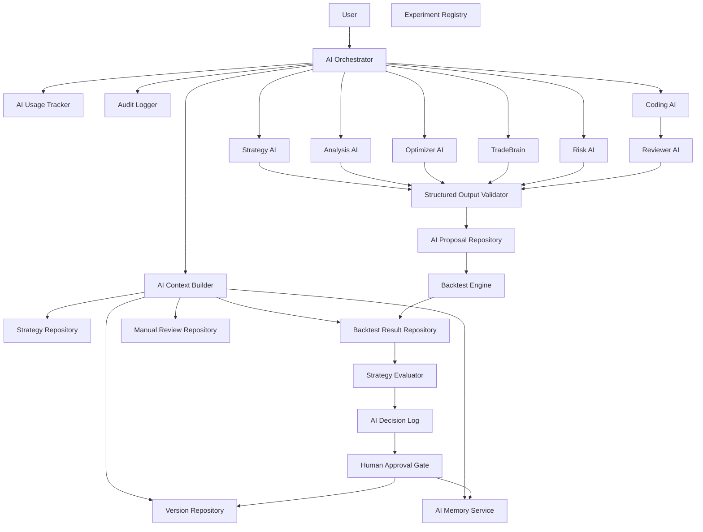
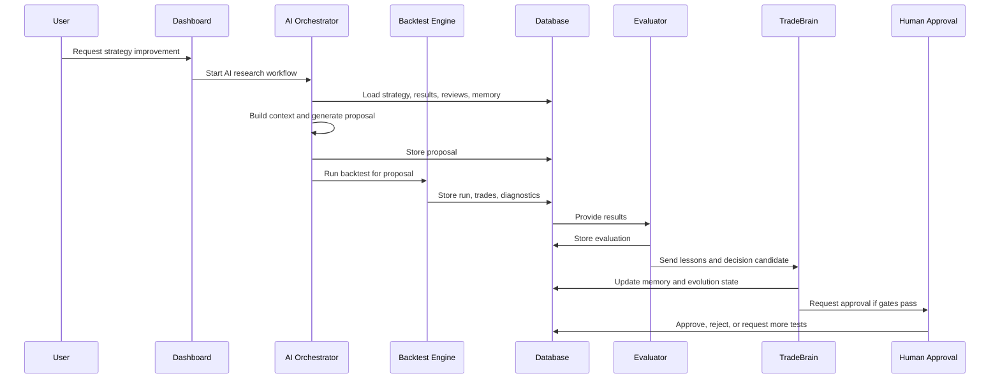

# DOC-002 Master Architecture

Project: AI Trade V2  
Role: Chief Software Architect  
Document purpose: One-year architecture blueprint for evolving the current AI Trade project into an AI Research Platform  
Date: 2026-07-01  
Implementation rule: This document is architecture only. No source code is modified by this document.

## Architecture Principle

AI Trade V2 must evolve from the current project. It must not be redesigned from zero.

The correct V2 direction is:

- Keep the existing trading-research logic that already works.
- Upgrade module boundaries around the current system.
- Replace only the parts that block scale, safety, or long-term development.
- Preserve the H4 + M15 price-action methodology.
- Keep the system local-first until security, audit, and production controls exist.
- Treat every AI output as a proposal until it passes validation and approval.
- Keep live trading fail-closed by default.

---

# 1. Vision

## Final Goal

AI Trade V2 will become an AI Research Platform for trading strategy research, testing, comparison, evolution, and eventually controlled production management.

The platform should help a trader and research team move from idea to validated strategy through a repeatable lifecycle:

```text
Idea
  -> Strategy specification
  -> Strategy implementation or rule compilation
  -> Backtest
  -> Evaluation
  -> Version comparison
  -> Human approval
  -> Production candidate
  -> Monitoring
  -> Continuous learning
```

The final product is not only a charting tool, not only a backtester, and not only an AI assistant. It is a research operating system for trading strategies.

## Trading Methodology

V2 keeps the current trading methodology:

- Price Action
- Supply and Demand
- Market Structure
- H4 context
- M15 confirmation
- Strategy versioning
- Manual review and calibration
- Backtest-first validation
- Human approval before production

The current H4 + M15 structure is a strategic asset. V2 should formalize it instead of replacing it with generic indicator logic.

## Platform Capabilities

AI Trade V2 must eventually support:

- MT5 connection.
- Market data import.
- Data quality checks.
- Strategy building.
- Strategy versioning.
- Automatic backtests.
- Backtest diagnostics.
- Result evaluation.
- Strategy comparison.
- Manual trade review.
- Learning from historical trades.
- AI-generated strategy ideas.
- AI-assisted strategy improvement.
- Strategy approval workflow.
- Production strategy registry.
- Multi-agent research automation.
- Continuous monitoring and learning.

## Non-Goals For Early V2

Early V2 should not attempt:

- Fully autonomous live trading.
- Direct MT5 order execution.
- Cloud deployment.
- Multi-user enterprise permissions.
- Replacing all existing PHP services immediately.
- Rewriting the full frontend in one step.

Those may become future capabilities, but the first V2 objective is to make the current project modular, safe, queryable, testable, and ready for AI-assisted research.

## Strategic Direction

AI Trade V2 should become:

- A strategy research lab first.
- An AI-assisted optimization platform second.
- A production strategy manager third.
- A live trading automation platform only after strong safety controls exist.

---

# 2. System Architecture

## Complete V2 Architecture

```mermaid
flowchart TB
    User["User / Trader / Researcher"]

    subgraph UI["Presentation Layer"]
        Dashboard["Dashboard"]
        StrategyUI["Strategy Builder"]
        BacktestUI["Backtest Studio"]
        ChartUI["Chart Workstation"]
        TrainerUI["Trainer and Manual Review"]
        CalibrationUI["Calibration Studio"]
        EvolutionUI["Evolution Lab"]
        CompareUI["Version Compare"]
        MT5UI["MT5 Data Center"]
        ProductionUI["Production Strategy Manager"]
        AgentUI["Agent Console"]
    end

    subgraph API["API and Application Layer"]
        Gateway["API Gateway / Router"]
        Auth["Local Auth and CSRF Guard"]
        Audit["Audit Logger"]
        BootstrapCtrl["Bootstrap Controller"]
        AccountCtrl["Account Controller"]
        StrategyCtrl["Strategy Controller"]
        VersionCtrl["Strategy Version Controller"]
        BacktestCtrl["Backtest Controller"]
        MarketCtrl["Market Data Controller"]
        MT5Ctrl["MT5 Controller"]
        ReviewCtrl["Manual Review Controller"]
        CalibrationCtrl["Calibration Controller"]
        TradeBrainCtrl["TradeBrain Controller"]
        ProductionCtrl["Production Controller"]
        AgentCtrl["Agent Controller"]
    end

    subgraph Research["Trading Research Core"]
        StrategyParser["Strategy Rule Parser"]
        StrategyCompiler["Strategy Compiler"]
        StructureDetector["Market Structure Detector"]
        ZoneDetector["Supply/Demand Zone Detector"]
        EntryConfirm["M15 Entry Confirmation"]
        BacktestEngine["Backtest Engine"]
        BacktestDiagnostics["Backtest Diagnostics"]
        DataQuality["Data Quality Checker"]
        StrategyEvaluator["Strategy Evaluator"]
        CalibrationReport["Calibration Report"]
        CalibrationAdvisor["Calibration Advisor"]
        PresetService["Calibrated Preset Service"]
        RiskEngine["Risk Engine"]
    end

    subgraph AI["AI and Agent Layer"]
        AIOrchestrator["AI Orchestrator"]
        StrategyAI["Strategy AI"]
        AnalysisAI["Analysis AI"]
        OptimizerAI["Optimizer AI"]
        TradeBrain["TradeBrain"]
        CodingAI["Coding AI"]
        ReviewerAI["Reviewer AI"]
        RiskAI["Risk AI"]
        MemoryService["AI Memory Service"]
        ContextBuilder["AI Context Builder"]
        UsageTracker["AI Usage Tracker"]
        AgentOrchestrator["Multi-Agent Orchestrator"]
    end

    subgraph Data["Data and Persistence Layer"]
        Repositories["Repository Interfaces"]
        SQLite["SQLite Research Database"]
        JsonAdapter["Legacy JSON Adapter"]
        ArtifactStore["Artifact Store"]
        EventLog["Append-only Event Log"]
        MarketStore["Market Data Store"]
        BacktestStore["Backtest Result Store"]
        VersionStore["Strategy Version Store"]
        ReviewStore["Manual Review Store"]
        TradeBrainStore["TradeBrain Store"]
    end

    subgraph External["External Integrations"]
        MT5Bridge["MT5 Bridge PHP"]
        PythonMT5["Python MetaTrader5 Bridge"]
        MT5Terminal["Local MT5 Terminal"]
        AIProvider["External AI Provider - future"]
        ImportExport["Import / Export Files"]
    end

    User --> UI
    UI --> Gateway
    Gateway --> Auth
    Gateway --> Audit
    Gateway --> BootstrapCtrl
    Gateway --> AccountCtrl
    Gateway --> StrategyCtrl
    Gateway --> VersionCtrl
    Gateway --> BacktestCtrl
    Gateway --> MarketCtrl
    Gateway --> MT5Ctrl
    Gateway --> ReviewCtrl
    Gateway --> CalibrationCtrl
    Gateway --> TradeBrainCtrl
    Gateway --> ProductionCtrl
    Gateway --> AgentCtrl

    StrategyCtrl --> StrategyParser
    StrategyCtrl --> StrategyCompiler
    BacktestCtrl --> BacktestEngine
    BacktestEngine --> StructureDetector
    BacktestEngine --> ZoneDetector
    BacktestEngine --> EntryConfirm
    BacktestEngine --> BacktestDiagnostics
    BacktestEngine --> RiskEngine
    BacktestCtrl --> StrategyEvaluator
    MarketCtrl --> DataQuality
    CalibrationCtrl --> CalibrationReport
    CalibrationCtrl --> CalibrationAdvisor
    CalibrationCtrl --> PresetService

    TradeBrainCtrl --> AIOrchestrator
    AgentCtrl --> AgentOrchestrator
    AIOrchestrator --> StrategyAI
    AIOrchestrator --> AnalysisAI
    AIOrchestrator --> OptimizerAI
    AIOrchestrator --> TradeBrain
    AIOrchestrator --> RiskAI
    AgentOrchestrator --> CodingAI
    AgentOrchestrator --> ReviewerAI
    AIOrchestrator --> ContextBuilder
    AIOrchestrator --> MemoryService
    AIOrchestrator --> UsageTracker
    ContextBuilder --> Repositories
    AIOrchestrator --> AIProvider

    API --> Repositories
    Research --> Repositories
    AI --> Repositories
    Repositories --> SQLite
    Repositories --> JsonAdapter
    Repositories --> ArtifactStore
    Repositories --> EventLog
    Repositories --> MarketStore
    Repositories --> BacktestStore
    Repositories --> VersionStore
    Repositories --> ReviewStore
    Repositories --> TradeBrainStore

    MT5Ctrl --> MT5Bridge
    MT5Bridge --> PythonMT5
    PythonMT5 --> MT5Terminal
    Repositories --> ImportExport
```



## Layer Responsibilities

### Presentation Layer

The UI becomes a feature-based research workstation.

Responsibilities:

- Display strategy state.
- Start backtests.
- Review diagnostics.
- Compare versions.
- Manage MT5 data.
- Review manual cases.
- Control AI workflows.
- Approve or reject strategy changes.
- Monitor production candidates.

Current modules reused:

- `index.php`
- `assets/app.js`
- `assets/styles.css`
- `assets/help-texts.js`

V2 direction:

- Keep the existing UI behavior.
- Split the UI into feature modules over time.
- Preserve the chart workstation.
- Avoid a full rewrite until backend and data boundaries are stable.

### API and Application Layer

The API becomes a routed application boundary instead of one large controller.

Responsibilities:

- Receive requests.
- Validate input.
- Enforce auth and CSRF.
- Route actions to application services.
- Emit consistent responses.
- Write audit events.
- Protect high-risk actions.

Current modules reused:

- `api.php`
- Existing service construction patterns.

V2 direction:

- Split actions into controllers.
- Keep compatibility with current frontend actions during migration.
- Introduce request/response contracts.
- Add local security before production features.

### Trading Research Core

This is the core of the project and should be protected.

Responsibilities:

- Parse strategy rules.
- Detect market structure.
- Detect supply/demand zones.
- Confirm M15 entries.
- Run backtests.
- Produce diagnostics.
- Evaluate results.
- Support calibration.
- Support risk preview and later risk governance.

Current modules reused:

- `BacktestEngine.php`
- `MarketStructureDetector.php`
- `SupplyDemandZoneDetector.php`
- `M15EntryConfirmation.php`
- `StrategyRuleParser.php`
- `StrategyEvaluator.php`
- `DataQualityChecker.php`
- `RiskCalculator.php`
- `RuleScorer.php`
- Calibration services.

V2 direction:

- Keep the methodology.
- Split `BacktestEngine.php` into smaller services.
- Preserve deterministic behavior.
- Add stronger result storage and experiment tracking.

### AI and Agent Layer

The AI layer coordinates strategy ideas, analysis, optimization, and controlled automation.

Responsibilities:

- Generate strategy ideas.
- Analyze backtest results.
- Propose strategy improvements.
- Optimize parameters.
- Maintain TradeBrain memory.
- Coordinate multiple AI agents.
- Validate AI output.
- Enforce budget and safety gates.

Current modules reused:

- `TradeBrainService.php`
- `TradeBrainAiService.php`
- `AiUsageTracker.php`
- `TradeBrainLiveSupervisor.php`
- `StrategyAiReviewer.php` as a legacy reference only.
- `agents/*`
- `scripts/agent-orchestrator.ts`

V2 direction:

- Promote mock AI boundaries into real provider adapters.
- Use structured proposal contracts.
- Keep all AI output as proposals.
- Require backtests and evaluation before approval.
- Keep Coding AI separate from Trading AI.

### Data and Persistence Layer

The data layer becomes repository-based and eventually SQLite-backed.

Responsibilities:

- Store strategy versions.
- Store market bars.
- Store backtest runs and trades.
- Store manual reviews.
- Store AI proposals, decisions, memory, and usage.
- Store audit events.
- Store generated artifacts.
- Provide query and pagination support.

Current modules reused:

- `JsonStore.php`
- `data/*.json`
- `data/backtests/*.json`
- `data/market_data/*.json`
- `data/tradebrain/*.json`

V2 direction:

- Keep JSON compatibility during migration.
- Introduce repository interfaces.
- Move high-volume data to SQLite.
- Keep exports as artifacts, not primary storage.

### External Integration Layer

External integrations must remain isolated.

Responsibilities:

- Connect to MT5.
- Import market data.
- Integrate future AI providers.
- Import/export snapshots and artifacts.

Current modules reused:

- `Mt5Bridge.php`
- `scripts/mt5_bridge.py`
- Import/export scripts.

V2 direction:

- Keep MT5 historical data fetch.
- Do not add order execution until production safety layer exists.
- Add integration health checks and audit logging.

## Current-to-V2 Transition Architecture

V2 should be introduced in three architectural states:

### State A: Compatibility Shell

Keep current UI and API actions running.

Add:

- Architecture documentation.
- Repository interfaces.
- Input validation helpers.
- Audit logging.
- SQLite behind selected repositories.

### State B: Modular Application

Split the application by feature.

Add:

- Controllers.
- Service boundaries.
- Frontend modules.
- Backtest engine subservices.
- Database migration.
- Paginated endpoints.

### State C: AI Research Platform

Add structured automation.

Add:

- AI orchestrator.
- Strategy AI.
- Optimizer AI.
- Analysis AI.
- TradeBrain memory retrieval.
- Experiment registry.
- Production strategy manager.
- Agent console.

---

# 3. Module Map

This module map describes the target V2 modules while showing how they depend on the existing project.

| Module | Purpose | Responsibilities | Dependencies | Future Expansion |
|---|---|---|---|---|
| Dashboard | Main research cockpit | Show account, strategy, backtest, AI, and production status | Bootstrap API, repositories, UI state | Personalized dashboards, alerts, experiment queue |
| Account Manager | Manage account/risk profiles | CRUD accounts, prop-firm settings, equity/risk previews | `RiskCalculator`, Account Repository | Broker sync, portfolio exposure |
| Strategy Builder | Create and edit strategy definitions | Rule editing, preset selection, H4/M15 rule configuration | `StrategyRuleParser`, Strategy Repository | AI-generated strategy specs, visual rule builder |
| Strategy Compiler | Convert strategy specs into executable research plans | Validate rules, normalize schema, produce backtest-ready config | Strategy Builder, Rule Parser | Strategy DSL, compatibility checks |
| Strategy Version Manager | Manage strategy versions and lifecycle | Parent/child versions, statuses, diffs, promotion gates | `StrategyVersionService`, Version Repository | Immutable event sourcing, rollback, approval signatures |
| Backtest Studio | Run and inspect backtests | Start runs, display metrics, diagnostics, trades, skipped reasons | Backtest Controller, Backtest Engine | Batch runs, distributed jobs, experiment comparison |
| Backtest Engine | Simulate strategy on historical data | Load data, apply H4/M15 rules, simulate orders, produce results | Market Data Store, detectors, entry confirmation | Multi-position engine, portfolio simulation, execution model |
| Backtest Diagnostics | Explain backtest decisions | Candidate setups, skipped reasons, zones, swings, trade context | Backtest Engine | Explainability UI, AI diagnostic summaries |
| Market Structure Detector | Detect H4/M15 structure | Swings, BOS, CHoCH, trend state, sideway state | OHLC data | More pattern types, confidence scores |
| Supply/Demand Zone Detector | Detect and track zones | Zone origin, lifecycle, touches, broken/fresh state | Market Structure Detector | Zone quality model, manual calibration feedback |
| M15 Entry Confirmation | Validate entry triggers | Touch, reaction candle, structure break, fake-break/QML proxy, SL/TP | H4 zones, M15 bars, strategy rules | More pattern modules, plug-in confirmations |
| Data Quality Center | Validate imported market data | Gaps, duplicates, invalid OHLC, range splits, metadata | `DataQualityChecker`, Market Store | Broker/session profiles, anomaly alerts |
| MT5 Data Center | Manage MT5 connection and import | Status, fetch bars, save data, list files | `Mt5Bridge`, Python bridge, Market Store | Scheduled imports, connection monitor |
| Chart Workstation | Visual research surface | Candles, indicators, zones, drawings, replay, trade overlays | Market Data API, Backtest API | Modular chart engine, worker rendering, annotation sharing |
| Trainer | Manual case review | Review candidates, score cases, save decisions | `RuleScorer`, Manual Review Repository | Active learning queue, quality controls |
| Manual Review Service | Normalize human labels | Candidate, zone, trade labels, import/export | Current `ManualReviewService` | Review workflows, reviewer confidence |
| Calibration Studio | Improve rules from manual feedback | Queues, reports, advisor recommendations, presets | Calibration services, Review Store | Statistical calibration, experiment-backed tuning |
| Calibration Queue Builder | Generate review queues | Select setups/trades/zones needing review | Backtest Engine, Market Store | Priority sampling, active learning |
| Calibration Report | Summarize review outcomes | Counts, error groups, rates, detector feedback | Review Store | Time-series calibration trends |
| Calibration Advisor | Recommend rule changes | Convert report findings into rule recommendations | Calibration Report, Strategy Parser | Optimizer integration, confidence scoring |
| Calibrated Preset Service | Create tuned presets | Apply recommendations to base presets | Calibration Advisor, Strategy Repository | Approval workflow, A/B tests |
| Strategy Evaluator | Decide if strategy improved | Train/validation/final metrics, risk gates, overfit warnings | Backtest Results, Version Store | Statistical tests, walk-forward scoring |
| Version Compare | Compare strategies | Metrics, diffs, train/validation/final comparison | Strategy Evaluator, Version Repository | Multi-version leaderboard |
| TradeBrain | Long-term strategy learning system | Memory, proposals, decisions, evolution workflow | AI Orchestrator, Backtest, Evaluation, Memory Store | Continuous learning, autonomous research loop |
| AI Orchestrator | Coordinate AI workflows | Select agents, build context, call AI, validate proposals | Context Builder, Usage Tracker, AI Providers | Multi-agent planning, workflow policies |
| Strategy AI | Generate and improve strategies | Create ideas, propose rule changes, explain rationale | Strategy Repository, Memory, Evaluation data | Strategy grammar, idea library |
| Analysis AI | Interpret results | Summarize backtests, diagnose failures, identify patterns | Backtest Results, Diagnostics | Natural-language research reports |
| Optimizer AI | Search for improvements | Propose parameter experiments, rank candidates | Experiment Registry, Backtest Engine | Bayesian/search optimization, robustness testing |
| Coding AI | Assist development, not trading execution | Draft code-change proposals, tests, refactor plans | Agent Console, Reviewer AI | Controlled development automation |
| Reviewer AI | Review code and research proposals | Risk review, regression review, policy checks | Coding AI, Audit Log | Security and strategy-review checklists |
| Risk AI | Analyze trading risk | Drawdown, concentration, rule safety, production risk | Evaluation, Production Manager | Risk warnings and kill-switch recommendations |
| AI Context Builder | Prepare AI inputs | Build compact context from strategies, results, memory, docs | Repositories, Artifact Store | Retrieval, prompt compression, context versioning |
| AI Memory Service | Store and retrieve learning | Lessons, failures, decisions, reusable insights | TradeBrain Store | Embedding/search memory |
| AI Usage Tracker | Enforce AI budgets | Calls, tokens, cost, daily limits | Current `AiUsageTracker`, AI Provider | Per-agent budgets, cost dashboard |
| Agent Console | UI for multi-agent work | Show tasks, runs, reviews, decisions | Agent Controller, Agent Store | Research workflows, development workflows |
| Multi-Agent Orchestrator | Run agent workflows | Director, Strategy, Backtest, Analysis, Reviewer, Coder agents | Existing `agents/*`, AI Orchestrator | Scheduled autonomous research |
| Production Strategy Manager | Manage approved strategies | Registry, deployment state, monitoring, rollback plans | Version Store, Risk Engine, Audit Log | Supervised live trading later |
| Live Supervisor | Fail-closed production safety | Validate plans, reject unsafe actions, monitor states | `TradeBrainLiveSupervisor`, Risk Engine | Broker execution gate, emergency stop |
| Risk Engine | Central risk rules | Account risk, strategy risk, exposure, drawdown limits | `RiskCalculator`, Production Manager | Portfolio and broker-level risk |
| API Gateway | Single request boundary | Routing, validation, response format, errors | Controllers, Auth, Audit | API versioning |
| Local Auth and CSRF Guard | Protect local app | Login/session, CSRF token, localhost safety | API Gateway | Multi-user auth later |
| Audit Logger | Track important changes | Strategy changes, imports, AI proposals, approvals | Event Log | Compliance export |
| Repository Layer | Hide storage implementation | Read/write/query entities | SQLite, JSON Adapter | Remote DB option later |
| SQLite Research Database | Main V2 data store | Queryable structured storage | Repositories | Backups, migrations |
| Legacy JSON Adapter | Migration bridge | Read existing JSON files, support compatibility | `JsonStore`, data files | Removed after migration |
| Artifact Store | Store large generated files | Exports, debug samples, snapshots | Filesystem, repositories | Retention, compression |
| Event Log | Append-only history | Strategy events, approvals, AI decisions, production events | Audit Logger | Replay and audit views |
| Import/Export Manager | Move data safely | Snapshots, manual reviews, memory, debug artifacts | Repositories, Artifact Store | Signed backups |
| Test Harness | Prevent regressions | Backend tests, strategy tests, safety tests | `tests/run.php` | CI, frontend tests, integration tests |
| Documentation System | Keep architecture current | Project docs, module docs, ADRs, runbooks | Existing docs | Developer portal |

---

# 4. Keep / Upgrade / Replace

The goal is reuse. Most existing modules should be kept or upgraded. Only a small number should be replaced because they block V2.

## KEEP

These modules should remain part of V2 because they contain valuable domain logic or safety foundations. Some may receive small improvements, but their core design should be preserved.

| Existing Module | Why Keep |
|---|---|
| `lib/MarketStructureDetector.php` | Core H4/M15 price-action logic. It directly supports the trading methodology. |
| `lib/SupplyDemandZoneDetector.php` | Core supply/demand zone detection and lifecycle logic. This is a V2 foundation. |
| `lib/M15EntryConfirmation.php` | Encapsulates M15 entry confirmation and keeps entry logic separate from raw backtest flow. |
| `lib/StrategyRuleParser.php` | Important normalization layer for current strategy rules and presets. It should evolve into the strategy compiler input. |
| `lib/StrategyEvaluator.php` | Provides evaluation gates for train/validation/final results. Needed for automated strategy evolution. |
| `lib/DataQualityChecker.php` | Necessary for reliable research. Bad market data must be detected before backtests or AI decisions. |
| `lib/RiskCalculator.php` | Useful account/risk preview base. Should become part of a larger Risk Engine. |
| `lib/RuleScorer.php` | Useful heuristic trainer/scoring service. Can support manual review and active learning. |
| `lib/ManualReviewService.php` | Important human-feedback foundation. Needed for calibration and continuous learning. |
| `lib/CalibrationQueueBuilder.php` | Converts backtest diagnostics into review work. This is valuable for active learning. |
| `lib/CalibrationReport.php` | Turns manual reviews into measurable calibration data. |
| `lib/CalibrationAdvisor.php` | Provides a practical first rule-improvement layer. |
| `lib/CalibratedPresetService.php` | Useful controlled bridge between calibration findings and strategy presets. |
| `lib/TradeBrainAiService.php` | Good AI service boundary. Keep the interface and replace mock internals later with provider adapters. |
| `lib/AiUsageTracker.php` | AI budget control is required for V2. Keep and expand. |
| `lib/TradeBrainLiveSupervisor.php` | Fail-closed supervisor is the correct safety posture. Keep as the production safety seed. |
| `lib/Mt5Bridge.php` | Historical MT5 bridge is useful. Keep for data import and harden later. |
| `scripts/mt5_bridge.py` | Existing Python MT5 bridge should remain the local MT5 adapter for historical data. |
| `scripts/batch_backtest.php` | Useful research runner. Keep as CLI access to batch experiments. |
| `scripts/demo_backtest.php` | Useful quick validation script. |
| `scripts/export_debug_samples.php` | Useful diagnostic export tool. Move outputs to managed artifact storage later. |
| `scripts/calibration_report.php` | Useful CLI entry for calibration reports. |
| `scripts/generate_tuned_preset.php` | Useful CLI entry for calibrated presets. |
| `scripts/export_manual_reviews.php` | Useful data portability tool. |
| `scripts/import_manual_reviews.php` | Useful data portability tool. |
| `tests/run.php` | Valuable regression test base. Keep and integrate with CI. |
| `config/defaults.php` | Useful seed/default source. Keep but eventually wrap in config service. |
| `.env.example` | Keep and expand for AI provider, DB, local security, and MT5 configuration. |
| `README.md` | Keep as local setup documentation, but fix encoding and update for V2. |
| `PROJECT_STATUS.md` | Keep as V1 status reference. |
| `BACKTEST_ENGINE_STATUS.md` | Keep as backtest design reference. |
| `MULTI_AGENT_SYSTEM.md` | Keep as agent-safety reference. |
| `TASKS.md` | Keep as backlog source until replaced by a formal task system. |
| `start-server.bat` | Keep as local development convenience. |
| `agents/types.ts` | Keep as initial agent data contract reference. |
| `agents/prompts/*.md` | Keep as seed prompts for future agents. |
| `agents/runs/*` | Keep as historical artifacts, but move future runs to managed artifact storage. |
| `agents/tasks/*` | Keep as current dry-run task artifacts, but replace workflow storage later. |

## UPGRADE

These modules should remain, but their structure must change for V2.

| Existing Module | Upgrade Direction | Why |
|---|---|---|
| `index.php` | Upgrade from full single-page markup to a dashboard shell with feature views | The UI is useful, but page responsibilities are too broad. |
| `assets/app.js` | Split into feature modules and chart modules | It currently owns too many domains and is the largest frontend risk. |
| `assets/styles.css` | Organize by layout, components, chart, forms, and feature views | Current CSS works but is tied to one large page. |
| `assets/help-texts.js` | Convert to structured help content by feature and field | Useful content, but should be easier to maintain and localize. |
| `api.php` | Upgrade into router plus controllers while keeping compatibility actions | Current single-controller design blocks security and scaling. |
| `lib/JsonStore.php` | Upgrade into repository-backed storage with JSON compatibility adapter | JSON is useful for migration, but should not remain primary storage. |
| `lib/BacktestEngine.php` | Split into loader, simulator, diagnostics, trade manager, scorer, and persistence | The engine is valuable but too large for V2 extension. |
| `lib/StrategyVersionService.php` | Upgrade to immutable version repository and lifecycle service | Current versioning is valuable but file-backed and mutable. |
| `lib/TradeBrainService.php` | Upgrade into an AI workflow service coordinated by AI Orchestrator | Current flow is a strong scaffold but mock-oriented. |
| `agents/adapters/directorAdapter.ts` | Upgrade from mock Director to research workflow planner | Needed for multi-agent research automation. |
| `agents/adapters/coderAdapter.ts` | Upgrade into development-only Coding AI adapter with strict review gates | Coding AI must remain separate from trading execution. |
| `agents/adapters/reviewerAdapter.ts` | Upgrade into policy, safety, code, and strategy reviewer | Reviewer AI will become a required gate. |
| `scripts/agent-orchestrator.ts` | Upgrade into multi-agent workflow runner with persisted tasks and audit | Existing dry-run runner is a useful base. |
| `data/accounts.json` | Migrate to Account Repository | Keep data, change storage. |
| `data/strategy.json` | Migrate to Strategy Repository | Keep current strategy, add schema/version migration. |
| `data/strategy_summary.json` | Migrate to Strategy Documentation/Playbook entity | Keep content, connect to versions. |
| `data/candidate_cases.json` | Migrate to Training Case Repository | Keep cases, add labels and outcomes. |
| `data/market_data/*.json` | Migrate to Market Data Store | Keep bars, add query/index/range support. |
| `data/tradebrain/tradebrain_profile.json` | Migrate to TradeBrain Profile entity | Keep profile, add schema. |
| `data/tradebrain/tradebrain_memory.json` | Migrate to AI Memory Store | Keep memory, add retrieval and versioning. |
| `data/tradebrain/ai_usage.json` | Migrate to AI Usage Events | Keep usage data, add per-agent budgets. |
| `data/tradebrain/ai_decisions.json` | Migrate to AI Decision Log | Keep decision history, add audit linkage. |
| `data/tradebrain/strategy_evaluations.json` | Migrate to Evaluation Repository | Keep evaluations, add query/comparison. |
| `data/tradebrain/strategy_upgrade_proposals.json` | Migrate to AI Proposal Repository | Keep proposals, add approval state. |

## REPLACE

These pieces should be replaced because they are legacy, generated, or unsuitable as V2 primary architecture.

| Existing Module / Asset | Replace With | Why |
|---|---|---|
| `lib/StrategyAiReviewer.php` | Strategy AI + Analysis AI + Reviewer AI pipeline | The current module is legacy/mock-oriented and references older fields. |
| Legacy client-side backtest logic inside `assets/app.js` | Server-side Backtest Engine and Backtest Studio | The real engine is server-side. Client simulation should not compete with it. |
| `data/strategy_versions.json` as primary store | Strategy Version Store in SQLite | Current file is large and mutable. V2 needs query, audit, and lifecycle events. |
| `data/backtests/backtest_runs.json` as primary store | Backtest Run Store in SQLite | Backtest runs require pagination, indexing, filtering, and metrics queries. |
| `data/backtests/backtest_trades.json` as primary store | Backtest Trade Store in SQLite | Trade rows should be queryable by run, symbol, reason, outcome, and version. |
| `data/exports/debug_samples_*.json` as unmanaged files | Managed Artifact Store | Large exports should have retention, metadata, and clear ownership. |
| `.chrome-profile*` generated folders | Excluded runtime artifacts | They are not source or architecture assets. |
| Screenshot check files as source documentation | Managed visual-test artifacts | Useful historically, but not part of core architecture. |
| Ad hoc bootstrap of all data | Feature-specific queries and cached summaries | V2 needs smaller payloads and independent page loading. |

---

# 5. AI Architecture

## AI Philosophy

AI in AI Trade V2 must be controlled, auditable, and research-oriented.

AI must not directly:

- Execute live trades.
- Modify production strategies without approval.
- Delete data.
- Promote strategies to production.
- Change platform source code without development review.

AI may:

- Propose ideas.
- Explain results.
- Suggest experiments.
- Generate strategy variations.
- Review risk.
- Summarize diagnostics.
- Assist development through separate Coding AI workflows.

## AI Architecture Diagram



## AI Components

### AI Orchestrator

Purpose:

- Central coordinator for all AI workflows.

Responsibilities:

- Select the right AI agent.
- Build context through AI Context Builder.
- Enforce usage budgets.
- Validate output schema.
- Save proposals and decisions.
- Trigger backtests.
- Request human approval.
- Prevent unsafe action.

Dependencies:

- AI Context Builder.
- AI Usage Tracker.
- AI Memory Service.
- Strategy Repository.
- Backtest Repository.
- Proposal Repository.
- Audit Logger.

Future expansion:

- Workflow policies.
- Multi-agent planning.
- Scheduled research loops.
- Agent performance scoring.

### Strategy AI

Purpose:

- Generate and improve strategy ideas based on the H4 + M15 methodology.

Responsibilities:

- Propose new strategy ideas.
- Convert user ideas into strategy specifications.
- Suggest rule changes.
- Explain why a rule may improve performance.
- Respect price-action, supply/demand, and market-structure constraints.

Communication:

- Receives structured context from AI Orchestrator.
- Returns `StrategyIdea`, `StrategySpec`, or `StrategyChangeProposal`.
- Never writes directly to active strategies.

### Analysis AI

Purpose:

- Interpret research results.

Responsibilities:

- Summarize backtest metrics.
- Identify weaknesses.
- Compare versions.
- Explain skipped setups.
- Identify overfitting signs.
- Produce research notes.

Communication:

- Reads backtest results, diagnostics, manual reviews, and version history.
- Writes analysis reports to artifacts and AI memory.

### Optimizer AI

Purpose:

- Propose experiments that can improve strategy quality.

Responsibilities:

- Identify tunable parameters.
- Generate experiment plans.
- Rank parameter candidates.
- Avoid overfitting by respecting validation/final splits.
- Recommend follow-up tests.

Communication:

- Writes experiment proposals.
- Backtest Engine executes experiments.
- Strategy Evaluator scores results.

### TradeBrain

Purpose:

- Long-term learning system for strategies.

Responsibilities:

- Store lessons from backtests and manual reviews.
- Remember failed changes.
- Recommend evolution paths.
- Link strategy versions to outcomes.
- Coordinate continuous learning loops.

Communication:

- Receives decisions and results from Evaluation.
- Feeds memory into Strategy AI and Optimizer AI.
- Never directly approves production.

### Coding AI

Purpose:

- Assist platform development only.

Responsibilities:

- Draft implementation plans.
- Suggest code changes.
- Generate tests.
- Explain technical debt.

Restrictions:

- Must not execute trading actions.
- Must not modify production strategies.
- Must pass Reviewer AI and human development review.

Communication:

- Works through Agent Orchestrator.
- Produces code-change proposals, not direct production decisions.

### Reviewer AI

Purpose:

- Review AI proposals, code proposals, and research outputs.

Responsibilities:

- Check for safety violations.
- Review overfitting risks.
- Review missing tests.
- Review strategy lifecycle violations.
- Check production readiness.

Communication:

- Receives proposals from AI Orchestrator or Coding AI.
- Returns approve/reject/needs-work review.

### Risk AI

Purpose:

- Provide risk-focused interpretation.

Responsibilities:

- Analyze drawdown.
- Identify concentration risk.
- Check production promotion risk.
- Flag unstable strategies.
- Recommend stricter gates.

Communication:

- Reads evaluation results, account profile, strategy rules, and production state.
- Produces risk reports.

## AI Communication Rules

All AI agents communicate through structured records:

- `AIContextSnapshot`
- `StrategyIdea`
- `StrategySpec`
- `StrategyChangeProposal`
- `ExperimentPlan`
- `BacktestRequest`
- `AnalysisReport`
- `RiskReview`
- `ApprovalRequest`
- `AIDecision`

No AI module should communicate by changing files directly. The AI Orchestrator persists proposals and decisions through repositories.

## AI Safety Gates

Every AI-generated strategy change must pass:

1. Structured output validation.
2. Strategy schema validation.
3. Backtest on train split.
4. Backtest on validation split.
5. Evaluation gate.
6. Risk review.
7. Human approval.
8. Version status update.

Production candidates require:

1. Final split test.
2. Out-of-sample review.
3. Manual approval.
4. Production risk profile.
5. Monitoring plan.
6. Rollback plan.

---

# 6. Data Flow

## Main Research Data Flow

```text
User
  -> Dashboard
  -> AI Orchestrator
  -> Strategy Proposal
  -> Backtest
  -> Database
  -> Evaluation
  -> Evolution
  -> Human Approval
  -> New Strategy Version
```

## Detailed Flow

### 1. User

The user starts from one of four entry points:

- Create a strategy idea.
- Run a backtest.
- Review a failed strategy.
- Ask TradeBrain to improve a version.

### 2. Dashboard

The dashboard displays:

- Current approved strategy.
- Active research versions.
- Latest backtest performance.
- Pending AI proposals.
- Manual review backlog.
- Data quality warnings.
- Production candidate status.

Dashboard requests should be summary-oriented. It should not load all raw trades, all market data, or all debug artifacts.

### 3. AI

AI Orchestrator builds context:

- Strategy version.
- Rules.
- Recent backtests.
- Manual review lessons.
- TradeBrain memory.
- Data quality status.
- User request.

AI then produces a structured proposal:

- New idea.
- Strategy change.
- Experiment plan.
- Analysis report.
- Risk review.

The proposal is stored before any action is taken.

### 4. Backtest

Backtest Engine receives:

- Strategy version or proposed rules.
- Symbol/timeframe range.
- Split type.
- Preset.
- Debug level.

Backtest Engine produces:

- Summary metrics.
- Trade rows.
- Setup candidates.
- Diagnostics.
- Zone/swing debug data.
- Score.

### 5. Database

The database stores:

- Request.
- Strategy version.
- Backtest run.
- Trades.
- Diagnostics.
- AI proposal.
- Evaluation.
- Decision.
- Audit event.

This makes every research decision reproducible.

### 6. Evaluation

Strategy Evaluator checks:

- Profit.
- Profit factor.
- Drawdown.
- Risk/reward.
- Win rate.
- Loss streak.
- Trade count.
- Train/validation/final consistency.
- Overfit signs.

Evaluation output becomes a decision candidate, not an automatic approval.

### 7. Evolution

TradeBrain uses results to:

- Record lessons.
- Mark failed ideas.
- Propose next changes.
- Promote strong versions to approval queue.
- Retire weak versions.

Evolution is a loop, not a single action.



---

# 7. Database Design

This is a high-level design only. No SQL is defined here.

## Database Direction

V2 should use SQLite as the primary local research database.

JSON remains useful for:

- Import/export.
- Backward compatibility.
- Human-readable snapshots.
- Generated artifacts.

SQLite becomes primary for:

- Queryable strategy versions.
- Backtest runs.
- Backtest trades.
- Manual reviews.
- Market data indexes.
- AI proposals.
- AI decisions.
- Audit events.

## Core Entities

### Workspace

Represents the local research workspace.

Relationships:

- Has many users.
- Has many strategies.
- Has many accounts.
- Has many market data sets.

### User

Represents a local platform user.

Relationships:

- Creates strategies.
- Approves versions.
- Saves manual reviews.
- Starts AI workflows.

Early V2 may have one local user, but the model should allow growth.

### Account Profile

Represents risk/account settings.

Relationships:

- Belongs to workspace.
- Used by risk previews.
- Used by production strategy risk checks.

### Broker Connection

Represents MT5 or future broker integration.

Relationships:

- Has connection status events.
- Provides market data imports.
- May later provide account/position snapshots.

### Symbol

Represents a market symbol such as EURUSD or GBPJPY.

Relationships:

- Has many market bars.
- Has many backtest runs.
- Has data quality reports.

### Timeframe

Represents H4, M15, or future timeframes.

Relationships:

- Used by market bars.
- Used by strategy rules.
- Used by backtest requests.

### Market Bar

Represents OHLCV data.

Relationships:

- Belongs to symbol.
- Belongs to timeframe.
- Belongs to data source/import batch.

### Market Data Import

Represents one MT5 fetch or data import.

Relationships:

- Has many market bars.
- Has data quality report.
- Has source metadata.

### Data Quality Report

Represents quality checks on market data.

Relationships:

- Belongs to symbol/timeframe/import.
- Can block backtest execution.

### Strategy

Represents a strategy family.

Relationships:

- Has many strategy versions.
- Has playbook documents.
- Has production deployments.

### Strategy Version

Represents a specific version of a strategy.

Relationships:

- Belongs to strategy.
- May have parent version.
- Has rule set.
- Has status.
- Has many backtest runs.
- Has evaluations.
- Has approval events.
- Has AI proposals.

### Rule Set

Represents the normalized strategy rules.

Relationships:

- Belongs to strategy version.
- Can be generated by human or AI.
- Can be compiled into a backtest plan.

### Strategy Version Event

Represents append-only lifecycle history.

Relationships:

- Belongs to strategy version.
- References user or AI decision.
- Records status changes, approvals, rejections, and promotions.

### Backtest Run

Represents one simulation.

Relationships:

- Belongs to strategy version.
- Belongs to symbol/timeframe set.
- Has many trades.
- Has diagnostics.
- Has metrics.
- Has evaluation.

### Backtest Trade

Represents one trade or skipped setup record.

Relationships:

- Belongs to backtest run.
- References symbol and timeframe.
- May reference zone, setup candidate, or diagnostic reason.

### Backtest Diagnostic

Represents explanatory data.

Relationships:

- Belongs to backtest run.
- Has setup candidates.
- Has skipped reasons.
- Has zones/swings summary.
- Can feed manual review queue.

### Experiment

Represents a group of related backtests.

Relationships:

- Has many backtest runs.
- Has objective.
- Has optimizer proposal.
- Has winner/loser versions.

### Evaluation

Represents result judgment.

Relationships:

- Belongs to strategy version or experiment.
- Reads one or more backtest runs.
- Produces decision candidate.
- Feeds TradeBrain memory.

### Manual Review

Represents human review of candidate, trade, or zone.

Relationships:

- Belongs to user.
- May reference strategy version.
- May reference backtest run/trade/diagnostic.
- Feeds calibration and memory.

### Calibration Queue Item

Represents one item needing human review.

Relationships:

- Generated from backtest diagnostics.
- May become manual review.
- Belongs to queue batch.

### Calibration Report

Represents aggregated review findings.

Relationships:

- Reads manual reviews.
- Produces calibration recommendations.

### Calibrated Preset

Represents a tuned rule preset.

Relationships:

- Based on base preset.
- Created from calibration recommendations.
- Requires approval before use.

### AI Proposal

Represents an AI-generated idea or change.

Relationships:

- Created by AI agent.
- References context snapshot.
- May create experiment.
- May create strategy version.
- Must have decision.

### AI Decision

Represents the outcome of an AI proposal.

Relationships:

- Belongs to proposal.
- References evaluation.
- May be approved or rejected by user.

### AI Context Snapshot

Represents the exact context sent to an AI agent.

Relationships:

- Belongs to proposal.
- References strategies, results, reviews, and memory.

### AI Usage Event

Represents AI cost/usage.

Relationships:

- Belongs to agent.
- Belongs to workflow.
- Used by budget controls.

### TradeBrain Memory

Represents reusable lessons.

Relationships:

- Created from evaluations, manual reviews, or AI analysis.
- Retrieved by AI Context Builder.
- Linked to strategy/version/symbol where relevant.

### Production Strategy

Represents a strategy approved for production monitoring.

Relationships:

- Points to approved strategy version.
- Has deployment state.
- Has risk profile.
- Has monitoring rules.

### Production Deployment

Represents a production or paper deployment instance.

Relationships:

- Belongs to production strategy.
- Has monitoring events.
- May later have broker position references.

### Monitoring Event

Represents production observations.

Relationships:

- Belongs to production deployment.
- Feeds continuous learning.

### Agent

Represents an AI or automation agent.

Relationships:

- Has runs.
- Has tasks.
- Has messages.
- Has usage events.

### Agent Run

Represents one multi-agent workflow run.

Relationships:

- Has tasks.
- Has messages.
- Has artifacts.
- Has review result.

### Audit Event

Represents important platform actions.

Relationships:

- References user, AI agent, strategy, version, import, proposal, approval, or production event.

### Artifact

Represents generated files.

Relationships:

- Belongs to run, experiment, import/export job, agent run, or report.
- Has retention policy.

## Key Entity Relationships

```text
Workspace
  -> Strategies
  -> Accounts
  -> Broker Connections
  -> Market Data

Strategy
  -> Strategy Versions
  -> Playbook Documents

Strategy Version
  -> Rule Set
  -> Backtest Runs
  -> Evaluations
  -> Version Events
  -> AI Proposals

Backtest Run
  -> Trades
  -> Diagnostics
  -> Metrics
  -> Evaluation

Manual Reviews
  -> Calibration Reports
  -> Calibration Recommendations
  -> Calibrated Presets

AI Proposal
  -> Context Snapshot
  -> Experiment / Backtest
  -> Evaluation
  -> AI Decision
  -> Human Approval

Production Strategy
  -> Approved Strategy Version
  -> Risk Profile
  -> Deployment
  -> Monitoring Events
```

---

# 8. Strategy Lifecycle

V2 must make strategy lifecycle explicit and enforceable.

## Lifecycle Flow

```text
Idea
  -> Specification
  -> Coding / Rule Compilation
  -> Compile
  -> Backtest
  -> Evaluation
  -> Approval
  -> Production
  -> Continuous Monitoring
```

## 1. Idea

Source:

- User.
- Strategy AI.
- TradeBrain memory.
- Backtest failure analysis.
- Manual review patterns.
- Optimizer AI.

Output:

- `StrategyIdea`
- Rationale.
- Expected market condition.
- H4/M15 assumptions.
- Risks.

Gate:

- Must be tied to methodology.
- Must not be vague.

## 2. Specification

The idea becomes a structured strategy specification.

Includes:

- Symbols.
- Timeframes.
- H4 structure rules.
- Supply/demand zone rules.
- M15 confirmation rules.
- Entry type.
- Stop loss logic.
- Take profit logic.
- Risk rules.
- Filters.
- Management rules.
- Invalidation rules.

Output:

- `StrategySpec`

Gate:

- Must pass schema validation.
- Must be human-readable.

## 3. Coding / Rule Compilation

Early V2 should prefer rule compilation over source-code generation.

Meaning:

- Strategy rules are compiled into a backtest-ready configuration.
- No platform source code is changed for normal strategy creation.

Coding AI may help only when the platform itself needs new capabilities.

Output:

- `RuleSet`
- `BacktestPlan`

Gate:

- No invalid fields.
- No unsupported rule types.
- No live execution behavior.

## 4. Compile

Compile validates that the strategy can be executed by the research engine.

Checks:

- Required H4 fields exist.
- Required M15 fields exist.
- Risk parameters are valid.
- Symbol/timeframe compatibility exists.
- Data availability exists.
- Strategy version can be created.

Output:

- Compiled strategy version.
- Compile warnings.

Gate:

- Compile errors block backtest.

## 5. Backtest

The backtest validates the strategy on historical data.

Required runs:

- Train.
- Validation.
- Final for promotion candidates.

Optional runs:

- Multi-symbol batch.
- Multi-year range.
- Stress test.
- Monte Carlo.
- Walk-forward.

Output:

- Backtest run.
- Trades.
- Metrics.
- Diagnostics.

Gate:

- Failed data quality blocks trusted evaluation.
- Insufficient samples produce warning or block promotion.

## 6. Evaluation

Evaluation decides whether results are meaningful.

Checks:

- Profit.
- Drawdown.
- Profit factor.
- Win rate.
- Loss streak.
- Risk/reward.
- Trade count.
- Validation consistency.
- Final consistency.
- Overfit warning.

Output:

- Evaluation report.
- Pass/fail/needs-more-data decision.

Gate:

- No strategy can advance without evaluation.

## 7. Approval

Approval is human-controlled.

Approval requires:

- Evaluation pass.
- Risk review.
- Explanation.
- Diff from parent version.
- Backtest evidence.
- Monitoring plan for production candidates.

Output:

- Approved version.
- Rejected version.
- Needs more testing.

Gate:

- AI cannot self-approve production.

## 8. Production

Production means the strategy is approved for monitoring or paper deployment first.

Early production stages:

- Research approved.
- Paper monitoring.
- Shadow mode.
- Supervised signal mode.
- Live trading only in future architecture.

Output:

- Production strategy record.
- Risk profile.
- Monitoring rules.
- Rollback plan.

Gate:

- No live orders until execution architecture exists.

## 9. Continuous Monitoring

Production strategies must be monitored.

Monitor:

- Signal frequency.
- Missed setups.
- Drawdown.
- Rule drift.
- Market regime changes.
- Data quality.
- Manual review feedback.
- AI alerts.

Output:

- Monitoring events.
- Lessons.
- Strategy improvement proposals.
- Retirement recommendations.

---

# 9. Future Automation

## Automation Maturity Levels

### Level 0: Manual Research

User manually edits strategy, runs backtest, reviews results.

Current project mostly operates here with some assisted workflows.

### Level 1: Assisted Research

AI explains results and suggests next experiments.

Human still controls:

- Strategy changes.
- Backtest requests.
- Version approval.

### Level 2: Semi-Automated Research

AI Orchestrator can:

- Generate experiment plans.
- Run approved backtest batches.
- Summarize results.
- Propose strategy changes.

Human still approves new versions.

### Level 3: Autonomous Research Loop

TradeBrain can:

- Pick weak strategies.
- Generate improvements.
- Run backtests.
- Evaluate results.
- Store lessons.
- Queue approval requests.

Human still approves promotion.

### Level 4: Production Recommendation

AI can recommend:

- Promote to paper monitoring.
- Keep in research.
- Retire strategy.
- Tighten risk.
- Start new experiment.

Human still approves all production changes.

### Level 5: Supervised Production Management

The system can:

- Monitor approved production strategies.
- Detect anomalies.
- Pause signals.
- Recommend rollback.
- Escalate alerts.

Human controls live execution.

### Level 6: Fully Autonomous Trading

This is a future-only target and should require:

- Proven research engine.
- Real execution engine.
- Broker reconciliation.
- Hard risk engine.
- Emergency stop.
- Monitoring.
- Audit.
- Legal/operational review.
- Extensive paper/live validation.

V2 should not start here.

## Autonomous Research Loop

```text
TradeBrain selects research target
  -> AI Orchestrator builds context
  -> Strategy AI proposes change
  -> Optimizer AI creates experiment plan
  -> Backtest Engine runs tests
  -> Strategy Evaluator scores results
  -> Analysis AI explains outcome
  -> Risk AI reviews risk
  -> TradeBrain stores lesson
  -> Human approval queue receives candidates
```

## Required Guardrails

Automation must stop when:

- Data quality fails.
- AI output fails schema validation.
- Backtest sample size is too small.
- Validation result is worse than parent.
- Drawdown exceeds allowed threshold.
- Risk AI rejects proposal.
- AI budget is exceeded.
- Required human approval is missing.
- Production strategy state is unsafe.

## Why This Is Practical

The existing project already has many pieces:

- Backtest engine.
- Strategy versioning.
- Evaluation.
- Manual reviews.
- Calibration.
- TradeBrain memory/proposal/decision stores.
- Usage tracker.
- Agent scaffold.

V2 automation should connect and harden these pieces instead of replacing them.

---

# 10. Development Roadmap

## Phase 1: V2 Foundation and Safety

Objective:

- Establish the architecture baseline without changing product behavior.

Work:

- Keep current app running.
- Add architecture documents.
- Define module boundaries.
- Add local security plan.
- Add repository interfaces.
- Add test execution habit.
- Define data migration plan.

Output:

- Clear V2 blueprint.
- Stable technical direction.
- No feature regression.

## Phase 2: Data Layer Upgrade

Objective:

- Move from large JSON files to queryable storage.

Work:

- Introduce SQLite.
- Build repository interfaces.
- Add JSON compatibility adapter.
- Migrate strategy versions.
- Migrate backtest runs/trades.
- Migrate manual reviews.
- Migrate TradeBrain stores.
- Keep export/import compatibility.

Output:

- Faster queries.
- Safer persistence.
- Better foundation for AI and automation.

## Phase 3: API Modularization and Security

Objective:

- Replace the single-controller API shape with safe, routed application boundaries.

Work:

- Add router.
- Split controllers.
- Add request validation.
- Add consistent response format.
- Add local auth.
- Add CSRF protection.
- Add audit logging.
- Keep existing action compatibility during migration.

Output:

- Safer API.
- Easier feature development.
- Better testability.

## Phase 4: Frontend Modularization

Objective:

- Split the browser app without losing current workflows.

Work:

- Create UI shell.
- Extract API client.
- Extract state store.
- Split feature views.
- Split chart engine.
- Split drawing tools.
- Keep current layout and behavior.

Output:

- Maintainable frontend.
- Feature-level ownership.
- Lower regression risk.

## Phase 5: Backtest Engine Modularization

Objective:

- Preserve engine behavior while making it extensible.

Work:

- Extract data loader.
- Extract range resolver.
- Extract simulator loop.
- Extract pending order manager.
- Extract trade manager.
- Extract diagnostics builder.
- Extract persistence.
- Add regression tests before and after.

Output:

- Testable backtest services.
- Ready for portfolio, optimizer, and diagnostics expansion.

## Phase 6: Strategy Lifecycle and Version Governance

Objective:

- Make strategy evolution controlled and auditable.

Work:

- Add formal statuses.
- Add append-only version events.
- Add approval records.
- Add version diff improvements.
- Add rollback path.
- Add strategy compile checks.
- Add promotion gates.

Output:

- Reliable strategy lifecycle.
- Safer AI-generated strategy changes.

## Phase 7: AI Orchestration

Objective:

- Move from mock TradeBrain to structured AI research workflows.

Work:

- Add AI Orchestrator.
- Add AI Context Builder.
- Add structured output validation.
- Add Strategy AI.
- Add Analysis AI.
- Add Optimizer AI.
- Add Risk AI.
- Keep mock mode as test mode.
- Add provider adapter later.

Output:

- AI can propose, analyze, and optimize through controlled contracts.

## Phase 8: Experiment and Optimization Platform

Objective:

- Make backtesting repeatable at experiment scale.

Work:

- Add experiment registry.
- Add batch queue.
- Add parameter search.
- Add comparison leaderboard.
- Add train/validation/final discipline.
- Add robustness metrics.

Output:

- Strategy optimization becomes systematic instead of ad hoc.

## Phase 9: Production Strategy Management

Objective:

- Prepare approved strategies for monitored production use without live execution yet.

Work:

- Add production strategy registry.
- Add monitoring state.
- Add risk profiles.
- Add paper/shadow mode records.
- Add alert model.
- Expand live supervisor.

Output:

- Approved strategies can be managed safely before live trading exists.

## Phase 10: Multi-Agent Research Automation

Objective:

- Let multiple agents perform controlled research loops.

Work:

- Upgrade agent orchestrator.
- Add Agent Console.
- Add task queues.
- Add agent run records.
- Add Reviewer AI gates.
- Add scheduled research jobs.

Output:

- AI agents can research, test, review, and report under supervision.

---

# 11. Sprint Plan

Assumption: Each sprint is approximately one to two weeks. The first 20 sprints focus on creating a durable V2 foundation while preserving the current product.

## Sprint 1: Architecture Baseline

Goal:

- Establish V2 direction and protect V1 behavior.

Modules:

- Documentation system.
- Current project inventory.
- Architecture reports.

Expected output:

- V2 architecture approved.
- Known module map.
- Keep/upgrade/replace decisions.
- No source behavior changes.

Dependencies:

- Existing architecture review.

## Sprint 2: Test and Safety Baseline

Goal:

- Make regression detection reliable before structural work starts.

Modules:

- `tests/run.php`
- Backtest Engine.
- Strategy services.
- Calibration services.
- TradeBrain services.

Expected output:

- Test execution checklist.
- Baseline test result record.
- Safety test list.
- Known failing/slow tests documented.

Dependencies:

- Sprint 1.

## Sprint 3: Data Inventory and Migration Plan

Goal:

- Design the data migration path from JSON to repositories.

Modules:

- `JsonStore.php`
- `data/*.json`
- `data/backtests/*.json`
- `data/market_data/*.json`
- `data/tradebrain/*.json`

Expected output:

- Entity inventory.
- File-to-entity mapping.
- Data size and retention plan.
- Migration priority list.

Dependencies:

- Sprint 1.

## Sprint 4: Repository Interface Design

Goal:

- Define storage contracts without changing storage yet.

Modules:

- Repository Layer.
- Account Repository.
- Strategy Repository.
- Version Repository.
- Backtest Repository.
- Market Data Repository.
- Review Repository.
- TradeBrain Repository.

Expected output:

- Repository contracts.
- JSON compatibility strategy.
- Read/write ownership rules.

Dependencies:

- Sprint 3.

## Sprint 5: SQLite Foundation

Goal:

- Introduce the future local database foundation.

Modules:

- SQLite Research Database.
- Migration Runner.
- Repository Layer.
- Config.

Expected output:

- Local database file plan.
- Migration mechanism.
- Backup/restore plan.
- First low-risk entity migrated in test mode.

Dependencies:

- Sprint 4.

## Sprint 6: Strategy Version Store Migration

Goal:

- Move strategy version governance toward queryable storage.

Modules:

- Strategy Version Repository.
- `StrategyVersionService`.
- Strategy Version Events.
- Legacy JSON Adapter.

Expected output:

- Strategy versions readable through repository.
- Parent/child relationships preserved.
- Version status history model defined.

Dependencies:

- Sprint 5.

## Sprint 7: Backtest Result Store Migration

Goal:

- Make backtest runs and trades queryable.

Modules:

- Backtest Run Repository.
- Backtest Trade Repository.
- `BacktestEngine` persistence boundary.
- Legacy JSON Adapter.

Expected output:

- Runs queryable by strategy, symbol, split, date, score.
- Trades queryable by run and outcome.
- Existing JSON data migratable.

Dependencies:

- Sprint 5, Sprint 6.

## Sprint 8: API Router and Controller Plan

Goal:

- Design and start the migration away from a single API controller.

Modules:

- `api.php`
- API Gateway.
- Controllers.
- Request validator.
- Response formatter.

Expected output:

- Route map.
- Controller boundaries.
- Backward-compatible action mapping.
- Error response standard.

Dependencies:

- Sprint 4.

## Sprint 9: API Security Baseline

Goal:

- Add local safety controls before AI automation expands.

Modules:

- Local Auth.
- CSRF Guard.
- Audit Logger.
- API Gateway.

Expected output:

- Local-only operating mode defined.
- Auth/session design.
- CSRF design for mutating requests.
- Audit events for high-risk actions.

Dependencies:

- Sprint 8.

## Sprint 10: Frontend Shell and API Client Split

Goal:

- Start frontend modularization at the safest boundary.

Modules:

- `index.php`
- `assets/app.js`
- API Client.
- State Store.
- Dashboard Shell.

Expected output:

- API calls isolated.
- State ownership documented.
- Dashboard shell boundary identified.
- Existing UI behavior preserved.

Dependencies:

- Sprint 8.

## Sprint 11: Chart Workstation Module Boundary

Goal:

- Protect and isolate the chart system.

Modules:

- Chart Workstation.
- Chart rendering.
- Indicators.
- Drawing tools.
- Replay.
- LocalStorage chart state.

Expected output:

- Chart module boundary.
- Drawing tool module plan.
- Indicator module plan.
- Regression checklist for chart behavior.

Dependencies:

- Sprint 10.

## Sprint 12: Backtest Engine Boundary Split

Goal:

- Split the backtest engine conceptually before deeper changes.

Modules:

- `BacktestEngine.php`
- Data Loader.
- Range Resolver.
- Simulator.
- Trade Manager.
- Diagnostics Builder.
- Persistence Adapter.

Expected output:

- Backtest service map.
- Existing behavior preservation tests.
- Extraction order.

Dependencies:

- Sprint 2, Sprint 7.

## Sprint 13: Backtest Diagnostics and Calibration Link

Goal:

- Strengthen the loop from backtest output to human review.

Modules:

- Backtest Diagnostics.
- Calibration Queue Builder.
- Manual Review Service.
- Calibration Report.

Expected output:

- Diagnostics stored in queryable form.
- Review queues linked to specific runs/trades/zones.
- Calibration reports reproducible.

Dependencies:

- Sprint 7, Sprint 12.

## Sprint 14: Strategy Lifecycle Governance

Goal:

- Make strategy promotion explicit and safe.

Modules:

- Strategy Version Manager.
- Version Events.
- Approval Workflow.
- Strategy Evaluator.
- Risk Engine.

Expected output:

- Lifecycle statuses finalized.
- Approval/rejection records.
- Promotion gates.
- Rollback model.

Dependencies:

- Sprint 6, Sprint 7.

## Sprint 15: AI Contracts and Context Builder

Goal:

- Prepare AI safely before connecting real providers.

Modules:

- AI Orchestrator.
- AI Context Builder.
- Structured Output Validator.
- AI Proposal Repository.
- AI Decision Log.
- Usage Tracker.

Expected output:

- AI input/output contracts.
- Context snapshot design.
- Proposal validation flow.
- Mock-mode workflow preserved.

Dependencies:

- Sprint 6, Sprint 7, Sprint 14.

## Sprint 16: TradeBrain V2 Workflow

Goal:

- Upgrade TradeBrain into a controlled evolution workflow.

Modules:

- `TradeBrainService`.
- TradeBrain Memory.
- Strategy AI.
- Analysis AI.
- Strategy Evaluator.
- Approval Workflow.

Expected output:

- TradeBrain can propose changes through V2 contracts.
- Proposals are stored.
- Backtests are linked.
- Evaluations and decisions are auditable.

Dependencies:

- Sprint 15.

## Sprint 17: Experiment Registry and Optimizer Loop

Goal:

- Turn optimization into managed experiments.

Modules:

- Experiment Registry.
- Optimizer AI.
- Batch Backtest.
- Backtest Store.
- Evaluation.

Expected output:

- Experiment entity.
- Parameter candidate model.
- Batch result comparison.
- Winner/loser tracking.

Dependencies:

- Sprint 12, Sprint 15, Sprint 16.

## Sprint 18: Evaluation and Compare Upgrade

Goal:

- Improve decision quality and visibility.

Modules:

- Strategy Evaluator.
- Version Compare.
- Analysis AI.
- Risk AI.
- Dashboard.

Expected output:

- Version comparison view backed by queryable data.
- Analysis reports linked to runs.
- Risk review added to promotion gates.

Dependencies:

- Sprint 14, Sprint 17.

## Sprint 19: MT5 Data Service Hardening

Goal:

- Make market data import more reliable and auditable.

Modules:

- `Mt5Bridge.php`
- `scripts/mt5_bridge.py`
- Market Data Repository.
- Data Quality Checker.
- Audit Logger.

Expected output:

- Import batches tracked.
- Data quality report linked to imports.
- Fetch history visible.
- No order execution added.

Dependencies:

- Sprint 5, Sprint 9.

## Sprint 20: Production Strategy Registry

Goal:

- Prepare for supervised production management without live trading.

Modules:

- Production Strategy Manager.
- Live Supervisor.
- Risk Engine.
- Strategy Version Manager.
- Monitoring Events.

Expected output:

- Approved strategy registry.
- Paper/shadow monitoring state.
- Risk profile per production candidate.
- Rollback and pause model.
- Explicit no-live-order boundary preserved.

Dependencies:

- Sprint 14, Sprint 18, Sprint 19.

## Post-Sprint-20 Direction

After the first 20 sprints, the platform should be ready for:

- Real AI provider adapter.
- Scheduled autonomous research loops.
- More advanced optimizer.
- Walk-forward and Monte Carlo testing.
- Agent Console.
- Production monitoring dashboard.
- Paper trading integration.
- Later, carefully designed live execution architecture.

---

# Final Architecture Summary

AI Trade V2 should not throw away the current project. The current system already contains valuable research intelligence:

- H4 market structure.
- Supply/demand zones.
- M15 confirmation.
- Backtesting.
- Diagnostics.
- Strategy versions.
- Calibration.
- TradeBrain scaffolding.
- MT5 data import.
- Safety-first live supervisor.

The V2 mission is to turn these pieces into a durable AI Research Platform.

The most important architecture moves are:

1. Introduce a repository and SQLite data layer.
2. Split the overloaded API into controllers.
3. Modularize the frontend gradually.
4. Split the backtest engine without changing its methodology.
5. Make strategy lifecycle explicit and auditable.
6. Add AI Orchestrator and structured AI proposal contracts.
7. Treat TradeBrain as a controlled learning system.
8. Add production strategy management before live trading.
9. Keep all automation fail-closed until the platform earns more autonomy.

The next year of development should focus on foundations first, automation second, and production trading last.
