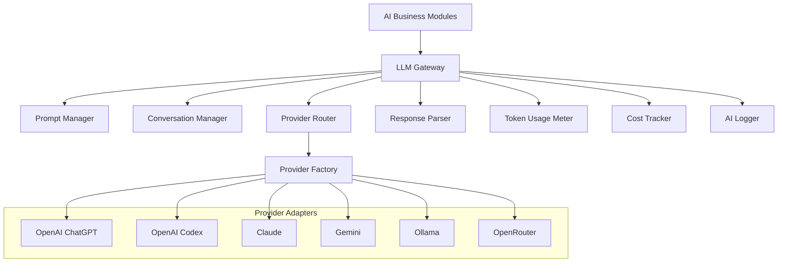

# DOC-004 LLM Gateway Architecture

Project: AI Trade V2  
Role: Lead Software Architect  
Document purpose: Unified LLM Gateway architecture for multiple AI providers  
Date: 2026-07-01  
Implementation rule: This document is architecture only. No production code is modified by this document.

## 1. Objective

AI Trade V2 needs one AI Gateway that can call different LLM providers without changing business logic.

Business modules such as TradeBrain, Strategy AI, Analysis AI, Optimizer AI, Risk AI, Coding AI, and Reviewer AI must depend on a stable gateway contract, not on provider-specific SDKs or API formats.

Supported providers:

- OpenAI ChatGPT.
- OpenAI Codex.
- Claude.
- Gemini.
- Ollama.
- OpenRouter.

The gateway must support provider switching through configuration, routing policy, or task policy while preserving the same application-level request and response contracts.

## 2. Design Rules

- Keep provider SDKs and HTTP formats outside business logic.
- Keep prompts versioned, testable, and reusable.
- Treat AI output as untrusted until parsed, validated, and approved.
- Track token usage and cost for every call.
- Log enough for audit and debugging without leaking secrets.
- Support local-only Ollama mode for offline research.
- Support timeout, retry, and fallback rules per task type.
- Keep Coding AI separate from Trading AI.
- Keep all live trading and production changes fail-closed.
- Do not hard-code current model names, provider prices, or API keys in business modules.

## 3. Target Module Map

```text
lib/
|-- AI/
|   |-- Gateway/
|   |   |-- LLMGateway
|   |   |-- ProviderInterface
|   |   |-- ProviderFactory
|   |   |-- ProviderRegistry
|   |   |-- ProviderRouter
|   |   |-- RetryPolicy
|   |   |-- TimeoutPolicy
|   |   |-- ResponseParser
|   |   |-- UsageMeter
|   |   |-- CostTracker
|   |   |-- LLMLogger
|   |   `-- RedactionPolicy
|   |-- Providers/
|   |   |-- OpenAIChatProvider
|   |   |-- OpenAICodexProvider
|   |   |-- ClaudeProvider
|   |   |-- GeminiProvider
|   |   |-- OllamaProvider
|   |   `-- OpenRouterProvider
|   |-- Prompts/
|   |   |-- PromptManager
|   |   |-- PromptTemplateRepository
|   |   |-- PromptRenderer
|   |   |-- PromptVersionPolicy
|   |   `-- PromptSafetyPolicy
|   |-- Conversation/
|   |   |-- ConversationManager
|   |   |-- ContextWindowManager
|   |   |-- ConversationRepository
|   |   `-- ContextSnapshotBuilder
|   `-- Contracts/
|       |-- LLMRequest
|       |-- LLMResponse
|       |-- PromptInput
|       |-- ParsedAIResult
|       |-- UsageRecord
|       `-- CostRecord
config/
`-- ai_providers
```

This is a target architecture map only. It does not require immediate creation of these files.

## 4. High-Level Architecture



## 5. Gateway Boundary

Business modules call the gateway with a provider-neutral request.

The request describes:

- Task type.
- Agent role.
- Prompt template key.
- Prompt variables.
- Conversation id.
- Required output format.
- Safety level.
- Timeout class.
- Budget class.
- Optional preferred provider.
- Optional preferred model.

The response returns:

- Normalized text.
- Parsed structured result when required.
- Provider name.
- Model name.
- Finish reason.
- Retry count.
- Token usage.
- Estimated or actual cost.
- Logging/audit identifiers.
- Validation status.
- Error category when failed.

The business layer never reads provider-specific response bodies directly.

## 6. Provider Interface

All provider adapters implement the same conceptual contract.

| Capability | Purpose |
|---|---|
| Provider identity | Return provider name, adapter version, supported features, and available model aliases. |
| Request normalization | Convert gateway requests into provider-specific payloads. |
| Completion call | Send the request to the provider and return a normalized raw response. |
| Usage extraction | Extract input tokens, output tokens, cached tokens, reasoning tokens, and provider-reported cost when available. |
| Error normalization | Convert provider errors into shared gateway categories. |
| Health check | Confirm whether the provider is configured and reachable. |
| Capability check | Declare support for JSON output, tool calls, streaming, image input, local execution, or long context. |

Shared error categories:

| Category | Meaning |
|---|---|
| `configuration_error` | Missing API key, invalid endpoint, missing local model, or unsupported model alias. |
| `authentication_error` | Provider rejected credentials. |
| `rate_limit` | Provider throttled the request. |
| `timeout` | Request exceeded gateway or provider timeout. |
| `network_error` | Transport failure or unavailable local server. |
| `provider_error` | Provider returned a service error. |
| `content_blocked` | Provider safety layer blocked the prompt or response. |
| `invalid_response` | Response could not be parsed into the required contract. |
| `budget_exceeded` | Gateway budget policy blocked the call. |

## 7. Provider Adapters

### OpenAI ChatGPT Provider

Primary use:

- Strategy analysis.
- Backtest explanation.
- Research summaries.
- Structured proposal generation.
- General AI assistant workflows.

Requirements:

- Support structured output where available.
- Support prompt/version metadata.
- Track usage from provider response.
- Use model aliases from configuration instead of hard-coded model names.

### OpenAI Codex Provider

Primary use:

- Development planning.
- Code review assistance.
- Test proposal generation.
- Controlled implementation planning.

Boundaries:

- Must not be used for live trading decisions.
- Must not directly modify production code through this gateway.
- Must remain separated from Strategy AI and Risk AI workflows.
- Outputs should be treated as development proposals or review notes.

### Claude Provider

Primary use:

- Long-form reasoning.
- Strategy critique.
- Risk review.
- Documentation and explanation.

Requirements:

- Normalize message format into gateway request format.
- Track provider-specific usage fields through `UsageMeter`.
- Handle provider-specific safety refusal states as normalized gateway errors or warnings.

### Gemini Provider

Primary use:

- Research synthesis.
- Large-context analysis.
- Multimodal expansion in future phases.

Requirements:

- Declare supported modalities per configured model.
- Normalize safety ratings and blocked responses.
- Keep image or file input support behind explicit capability flags.

### Ollama Provider

Primary use:

- Local offline research.
- Private prompt testing.
- Low-cost development and regression tests.
- Fallback for non-critical summarization.

Requirements:

- Use local endpoint configuration.
- Detect whether the requested local model is available.
- Track estimated token usage when exact usage is unavailable.
- Record local compute cost as zero by default unless configured otherwise.
- Mark responses as local-provider output for audit.

### OpenRouter Provider

Primary use:

- Provider aggregation.
- Experiments across third-party hosted models.
- Fallback routing when direct provider integration is unavailable.

Requirements:

- Store both gateway provider and upstream model/provider identity.
- Track provider-reported usage and cost when available.
- Enforce model allowlist because OpenRouter can expose many models.
- Keep OpenRouter model selection behind routing policy, not business code.

## 8. Provider Factory

The Provider Factory creates provider adapters from configuration.

Responsibilities:

- Load enabled providers.
- Validate required credentials or local endpoints.
- Map model aliases to provider-specific model identifiers.
- Inject timeout, retry, logging, and HTTP client settings.
- Return adapters by provider key.
- Fail fast for invalid provider configuration.

Provider keys:

| Provider key | Adapter |
|---|---|
| `openai_chat` | OpenAI ChatGPT provider adapter. |
| `openai_codex` | OpenAI Codex provider adapter. |
| `claude` | Claude provider adapter. |
| `gemini` | Gemini provider adapter. |
| `ollama` | Ollama local provider adapter. |
| `openrouter` | OpenRouter provider adapter. |

Configuration should define model aliases by task instead of forcing business modules to know provider model names.

Example alias categories:

| Alias | Intended use |
|---|---|
| `analysis_default` | Normal strategy and backtest analysis. |
| `structured_default` | JSON or schema-bound output. |
| `long_context` | Large strategy, run, or memory summaries. |
| `local_fast` | Local low-cost draft or smoke-test output. |
| `coding_default` | Coding AI and Reviewer AI only. |
| `risk_review` | Risk AI review and promotion gates. |

## 9. Provider Router

The Provider Router decides which provider and model alias to use for each request.

Routing inputs:

- Explicit provider override.
- Task type.
- Agent role.
- Required capabilities.
- Token budget.
- Cost budget.
- Privacy level.
- Latency target.
- Provider health.
- Retry/fallback policy.

Routing examples:

| Task | Preferred route | Fallback route |
|---|---|---|
| Strategy proposal | `openai_chat` or `claude` with `structured_default` | `openrouter` allowlisted structured model |
| Backtest summary | `openai_chat` with `analysis_default` | `ollama` with `local_fast` |
| Risk review | `claude` or `openai_chat` with `risk_review` | No automatic fallback unless policy allows |
| Coding review | `openai_codex` with `coding_default` | `claude` only when configured for development tasks |
| Offline prompt test | `ollama` with `local_fast` | None |

High-risk tasks should not silently fallback to weaker or unapproved providers.

## 10. Prompt Manager

The Prompt Manager owns prompt selection, rendering, safety framing, and prompt versioning.

Responsibilities:

- Resolve prompt template by key.
- Load the approved template version.
- Validate required variables.
- Render prompt with explicit context sections.
- Attach system/developer instructions.
- Add safety constraints for trading research.
- Add output schema instructions when needed.
- Record prompt version in every usage and audit record.

Prompt template categories:

| Category | Example template keys |
|---|---|
| Strategy AI | `strategy.idea.generate`, `strategy.version.improve`, `strategy.rules.explain` |
| Analysis AI | `backtest.summary`, `diagnostics.explain`, `experiment.compare` |
| Optimizer AI | `optimizer.plan`, `optimizer.rank_candidates` |
| Risk AI | `risk.review_strategy`, `risk.production_gate` |
| TradeBrain | `tradebrain.lesson.extract`, `tradebrain.memory.retrieve`, `tradebrain.proposal.review` |
| Coding AI | `coding.plan`, `coding.review`, `test.gap_analysis` |

Prompt rendering rules:

- Separate instructions from data.
- Include strategy and backtest identifiers, not only prose.
- Include source timestamps for data snapshots.
- Include explicit output contract.
- Include "proposal only" language for AI-generated trading changes.
- Avoid including secrets, API keys, cookies, or local credentials.

## 11. Prompt Templates

Prompt templates should be stored as versioned artifacts.

Each template record should include:

- Template key.
- Version.
- Owner module.
- Purpose.
- Required variables.
- Optional variables.
- Expected response parser.
- Safety level.
- Last reviewed date.
- Deprecation status.

Template lifecycle:

```text
Draft
  -> Review
  -> Approved
  -> Active
  -> Deprecated
  -> Archived
```

Prompt changes must be auditable because prompt changes can change strategy recommendations even when application code does not change.

## 12. Conversation Manager

The Conversation Manager stores and retrieves conversation state independently from any provider.

Responsibilities:

- Create conversation ids.
- Store normalized messages.
- Store provider call ids.
- Track prompt template versions used in each turn.
- Maintain task, agent, and strategy references.
- Build context windows under model limits.
- Summarize older turns when context is too large.
- Support conversation reset and archival.

Conversation message types:

| Type | Purpose |
|---|---|
| `system` | Stable safety and role instructions. |
| `developer` | Application-level constraints and output contracts. |
| `user` | User or business module request. |
| `context` | Strategy, backtest, memory, or repository data. |
| `assistant` | Provider response. |
| `tool_result` | Future controlled tool output or application result. |
| `summary` | Gateway-created conversation summary. |

The conversation store must be provider-neutral so a conversation can continue through a different provider when policy allows.

## 13. Context Window Management

The Context Window Manager prepares the final message set for a provider.

Responsibilities:

- Estimate tokens before the call.
- Trim low-priority context.
- Summarize older conversation turns.
- Preserve required safety and output instructions.
- Preserve strategy ids, backtest ids, and evaluation ids.
- Reject the call when required context cannot fit safely.

Priority order:

1. Safety and system constraints.
2. Required output schema.
3. Current user/task request.
4. Strategy or backtest object being analyzed.
5. Recent conversation turns.
6. Relevant memory.
7. Historical examples.
8. Optional explanatory context.

## 14. Response Parser

The Response Parser converts provider output into application-level results.

Parser modes:

| Mode | Purpose |
|---|---|
| `plain_text` | Human-readable explanation or summary. |
| `json_object` | Single structured result. |
| `json_array` | Ranked candidates or lists. |
| `schema_bound` | Strict contract for strategy proposals, risk reviews, or experiment plans. |
| `markdown_report` | Research report with controlled sections. |
| `code_review_report` | Development review findings. |

Parser responsibilities:

- Extract text from provider-specific response shape.
- Parse JSON or structured output.
- Validate required fields.
- Normalize missing optional fields.
- Reject unknown high-risk actions.
- Attach parser warnings.
- Produce a validation status.

Structured AI outputs should be stored as proposals, not automatically applied to trading configuration.

## 15. Token Usage

The Usage Meter records normalized usage for every call.

Fields:

| Field | Meaning |
|---|---|
| `usage_id` | Unique gateway usage record id. |
| `conversation_id` | Conversation reference. |
| `request_id` | Gateway request reference. |
| `provider` | Gateway provider key. |
| `upstream_provider` | Upstream provider when routed through OpenRouter. |
| `model_alias` | Application model alias. |
| `model_name` | Provider model identifier. |
| `input_tokens` | Prompt/input tokens. |
| `output_tokens` | Completion/output tokens. |
| `cached_tokens` | Cached tokens when provider reports them. |
| `reasoning_tokens` | Reasoning tokens when provider reports them. |
| `estimated` | Whether usage is estimated instead of provider-reported. |
| `started_at` | Request start timestamp. |
| `finished_at` | Request finish timestamp. |
| `latency_ms` | End-to-end gateway latency. |

When provider token counts are unavailable, the gateway records estimated tokens and marks the record as estimated.

## 16. Cost Tracking

The Cost Tracker converts usage records into cost records.

Responsibilities:

- Store provider-reported cost when available.
- Estimate cost from configured pricing when provider cost is not returned.
- Support zero-cost local providers such as Ollama.
- Track cost by provider, model alias, agent role, task type, strategy id, and date.
- Enforce budget policies before and after provider calls.
- Record currency and pricing version.

Budget scopes:

| Scope | Example |
|---|---|
| Per request | Maximum cost for a single call. |
| Per conversation | Budget for one strategy analysis thread. |
| Per agent | Daily Strategy AI or Coding AI limit. |
| Per workflow | Budget for an experiment or TradeBrain run. |
| Per day | Overall daily AI spend cap. |
| Per provider | Provider-specific spend cap. |

Cost tables must not hard-code public pricing. Pricing should be configuration-driven and reviewable because provider prices change.

## 17. Retry Logic

Retry policy belongs to the gateway, not to business modules.

Retryable errors:

- Network errors.
- Provider timeouts.
- Rate limits when retry-after is acceptable.
- Temporary provider errors.
- Invalid structured output when parser policy allows one repair attempt.

Non-retryable errors:

- Missing credentials.
- Invalid model alias.
- Budget exceeded.
- Safety blocked content.
- Validation failure for high-risk trading action.
- Unsupported provider capability.

Retry behavior:

| Task risk | Retry policy |
|---|---|
| Low-risk summary | Retry with backoff, then optional fallback. |
| Strategy proposal | Retry once, then fallback only to approved structured-output provider. |
| Risk review | Retry with same provider class; do not downgrade automatically. |
| Coding AI | Retry based on development policy; no trading-side fallback. |
| Local test | Retry quickly; no external fallback unless explicitly requested. |

Retries must preserve the same request id family so usage and logs show one logical operation.

## 18. Timeout

Timeout policy should be configured by task class.

Timeout classes:

| Class | Use |
|---|---|
| `fast` | UI summaries, labels, quick explanations. |
| `normal` | Strategy analysis and standard TradeBrain calls. |
| `long` | Large backtest reports or long-context reasoning. |
| `batch` | Background experiment summaries. |
| `local` | Ollama local calls with local endpoint rules. |

Timeout handling:

- The gateway sets a client-side timeout.
- The provider adapter may set provider-specific timeout parameters when supported.
- Timeout errors are logged and categorized.
- Business modules receive a normalized timeout result.
- Background jobs may retry according to workflow policy.

## 19. Logging and Audit

The gateway logs all AI calls through an AI Logger.

Log levels:

| Level | Purpose |
|---|---|
| Operational log | Request timing, provider, model alias, success/failure. |
| Usage log | Tokens, cost, budget scope, latency. |
| Prompt audit log | Prompt template key, version, variable names, context snapshot id. |
| Response audit log | Parser status, output hash, proposal id. |
| Error log | Normalized error category and retry/fallback details. |

Redaction rules:

- Never log API keys.
- Never log raw credentials or session tokens.
- Avoid logging full prompts by default.
- Store prompt and response hashes for correlation.
- Allow full prompt capture only in local development or explicit audit mode.
- Redact user-provided secrets from prompt variables before storage.

Audit events should link AI output to downstream decisions such as strategy proposal creation, rejection, approval, or experiment creation.

## 20. Provider Switching

Provider switching must happen at the gateway boundary.

Business logic should specify:

- Task type.
- Agent role.
- Required output format.
- Safety level.
- Optional provider preference.

Business logic should not specify:

- Provider-specific HTTP payloads.
- Provider-specific response parsing.
- Provider-specific token fields.
- Provider-specific retry code.
- Provider-specific pricing math.

Switching examples:

| Business module | Stable call intent | Provider can change? |
|---|---|---|
| TradeBrain | Generate proposal from strategy memory and evaluation data. | Yes, if structured output is supported. |
| Analysis AI | Summarize backtest run diagnostics. | Yes, broad fallback allowed. |
| Optimizer AI | Generate experiment candidate set. | Yes, but parser must validate schema. |
| Risk AI | Review production promotion risk. | Limited, only approved risk-review providers. |
| Coding AI | Produce implementation plan or review. | Yes, but only development providers. |

The gateway response contract remains the same after switching providers.

## 21. Persistence Design

Recommended persisted entities:

| Entity | Purpose |
|---|---|
| `ai_provider_configs` | Enabled providers, endpoint references, model aliases, capability flags. |
| `ai_prompt_templates` | Versioned prompt templates and metadata. |
| `ai_conversations` | Conversation header and ownership references. |
| `ai_messages` | Normalized conversation turns. |
| `ai_context_snapshots` | Hashable context bundles used for a request. |
| `ai_requests` | Gateway request metadata. |
| `ai_responses` | Normalized response metadata and output references. |
| `ai_usage_records` | Token and latency records. |
| `ai_cost_records` | Cost records and pricing version. |
| `ai_gateway_events` | Retry, fallback, parser, and provider health events. |

Early V2 may keep these records in JSON through repository interfaces. Later V2 should migrate them to SQLite with append-style audit tables.

## 22. Security and Secrets

Provider credentials must be kept outside source code.

Credential rules:

- Use environment variables or local secrets config excluded from source control.
- Never expose provider keys to frontend JavaScript.
- Never store credentials in prompt templates.
- Never include credentials in logs or audit records.
- Keep local Ollama endpoint configuration separate from cloud API credentials.

Network rules:

- Cloud provider calls require explicit provider enablement.
- Local-only mode must block cloud fallback.
- High-risk workflows should record whether data left the machine.

## 23. Safety for Trading Workflows

The gateway supports trading research but must not make trading execution decisions by itself.

Safety gates:

- AI-generated strategy changes are proposals.
- AI-generated risk reviews are advisory until approved.
- AI cannot approve its own production recommendation.
- AI output must pass parser validation before storage.
- AI output must pass domain validation before becoming a strategy version.
- Live trading actions are out of scope for this gateway.

High-risk output examples that must be rejected or downgraded to proposals:

- Direct order instructions.
- Unvalidated position sizing changes.
- Production promotion without evaluation evidence.
- Strategy modification without a linked version and backtest plan.
- Claims based on missing or stale market data.

## 24. Failure Modes

| Failure | Gateway behavior |
|---|---|
| Provider unavailable | Return normalized error; optionally fallback if task policy allows. |
| Provider returns malformed JSON | Parser rejects; optional repair retry for low/medium risk tasks. |
| Cost budget exceeded | Block call before provider request where possible. |
| Context too large | Summarize or trim optional context; reject if required context cannot fit. |
| Prompt template missing | Fail fast with configuration error. |
| Provider blocked content | Log content-blocked status and return controlled failure. |
| Local Ollama model missing | Return configuration error with model alias and provider key. |
| OpenRouter upstream changes | Block non-allowlisted models and record upstream identity. |

## 25. Integration With Existing AI Trade Modules

Current modules should migrate toward the gateway gradually.

| Existing area | Gateway role |
|---|---|
| `TradeBrainService` | Calls Strategy AI and Analysis AI through gateway instead of direct/mock provider logic. |
| `TradeBrainAiService` | Becomes a thin workflow service or is replaced by AI Orchestrator calls. |
| `AiUsageTracker` | Evolves into or delegates to Usage Meter and Cost Tracker. |
| `StrategyAiReviewer` | Becomes a legacy reference or one adapter around a Reviewer AI prompt. |
| `agents/*` | Uses Coding AI and Reviewer AI task types through the gateway when real providers are enabled. |

Migration should keep mock mode available for tests and local development.

## 26. Request Lifecycle

```text
Business module creates AI task
  -> LLM Gateway receives provider-neutral request
  -> Prompt Manager resolves and renders template
  -> Conversation Manager loads relevant turns and context
  -> Context Window Manager trims or summarizes context
  -> Provider Router selects provider and model alias
  -> Provider Factory returns configured adapter
  -> Gateway checks budget and timeout policy
  -> Provider adapter sends request
  -> Retry policy handles retryable failures
  -> Response Parser normalizes and validates output
  -> Usage Meter records tokens and latency
  -> Cost Tracker records actual or estimated cost
  -> Logger writes audit events
  -> Gateway returns provider-neutral response
  -> Business module stores proposal, report, or failure
```

## 27. Background Jobs and UI Calls

The gateway should support both synchronous UI calls and asynchronous background jobs.

UI calls:

- Use fast or normal timeout classes.
- Return clear failure messages.
- Avoid expensive long-context calls.
- Show usage/cost only where useful.

Background jobs:

- Use normal, long, or batch timeout classes.
- May retry according to workflow policy.
- Must record progress events.
- Must persist intermediate failures.
- Should link outputs to experiment, strategy, or TradeBrain run ids.

## 28. Testing Strategy

Gateway testing should not require paid provider calls by default.

Test layers:

| Layer | Purpose |
|---|---|
| Contract tests | Ensure every provider adapter returns normalized responses and errors. |
| Prompt rendering tests | Verify required variables, template versions, and safety text. |
| Parser tests | Validate structured output parsing and rejection behavior. |
| Retry tests | Simulate rate limit, timeout, malformed output, and fallback. |
| Usage tests | Verify token and cost records are created for success and failure cases. |
| Mock provider tests | Run CI/local tests without external network calls. |
| Optional live smoke tests | Manually verify configured providers when credentials exist. |

Mock provider mode must remain first-class for deterministic tests.

## 29. Rollout Plan

### Phase 1: Architecture and Contracts

- Approve gateway architecture.
- Define provider-neutral request and response contracts.
- Define prompt template metadata.
- Define usage and cost record schema.
- Keep current mock AI behavior unchanged.

### Phase 2: Prompt and Conversation Foundation

- Add prompt template repository.
- Add prompt rendering and validation.
- Add conversation records.
- Add context snapshot records.
- Add parser contracts for existing AI outputs.

### Phase 3: Mock Provider and Usage Tracking

- Add mock provider adapter.
- Route current AI workflows through gateway in mock mode.
- Record usage and cost as zero or estimated.
- Add tests for parser, retry, and logging behavior.

### Phase 4: First Real Provider

- Enable one cloud provider through configuration.
- Add manual live smoke test.
- Keep mock mode as default for automated tests.
- Add budget and timeout enforcement.

### Phase 5: Multi-Provider Routing

- Add remaining provider adapters.
- Add provider health checks.
- Add fallback rules by task class.
- Add local-only Ollama mode.
- Add OpenRouter allowlist policy.

### Phase 6: AI Workflow Integration

- Move TradeBrain, Strategy AI, Analysis AI, Optimizer AI, Risk AI, Coding AI, and Reviewer AI onto the gateway.
- Store proposals and reports through repositories.
- Add dashboard usage and cost views.
- Add audit links from AI calls to downstream decisions.

## 30. Architecture Summary

The LLM Gateway is the provider boundary for AI Trade V2.

It separates business logic from provider APIs, centralizes prompt and conversation control, normalizes usage and cost, and makes AI behavior auditable.

The most important architecture decisions are:

1. Business modules call one provider-neutral gateway.
2. Provider adapters hide SDK and API differences.
3. Prompt templates are versioned and auditable.
4. Conversation history is provider-neutral.
5. Token usage and cost tracking happen for every call.
6. Retry, timeout, fallback, and budget policies live in the gateway.
7. Response parsing and validation happen before business modules consume AI output.
8. Provider switching is configuration and policy driven.
9. Ollama is supported as a local provider, not a special business path.
10. Trading AI output remains proposal-only until validated and approved.

